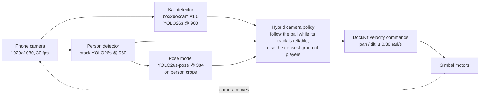
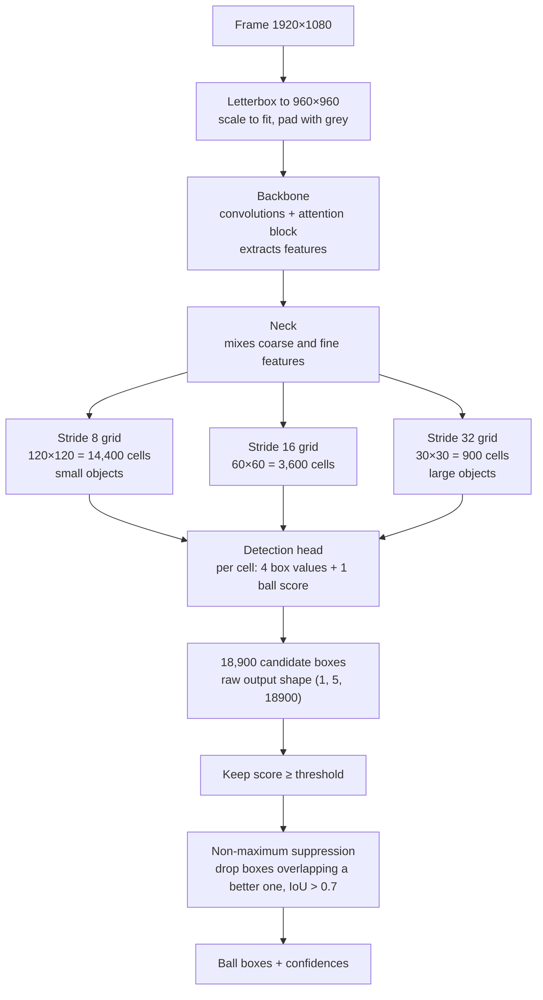
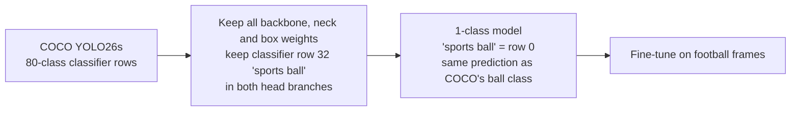
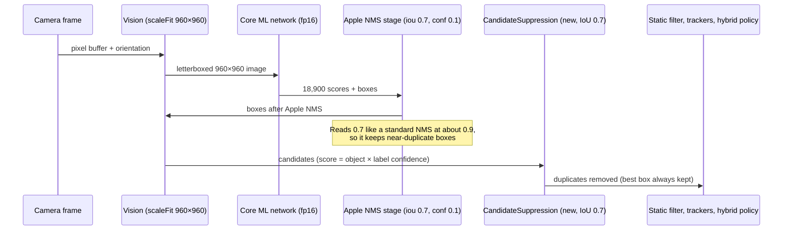
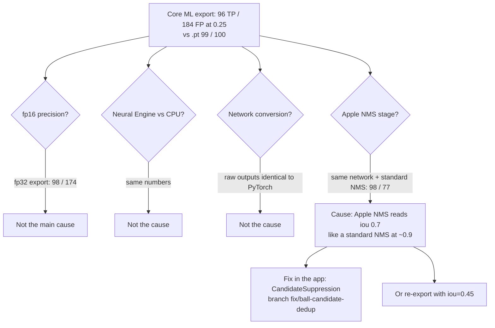
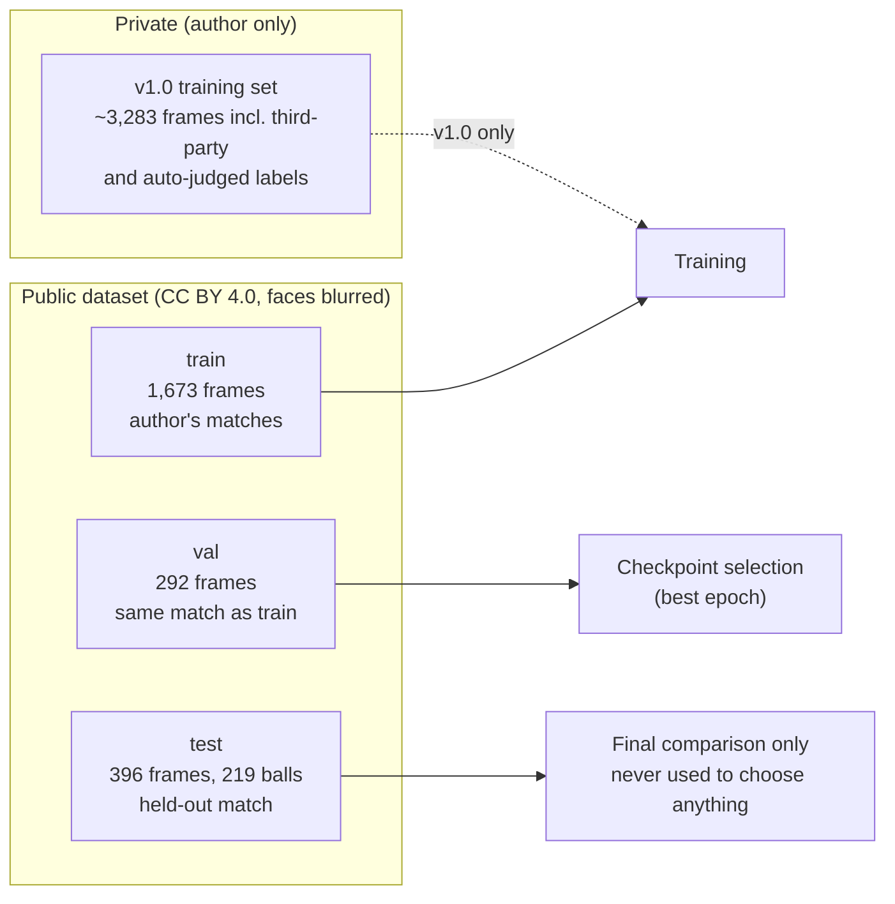
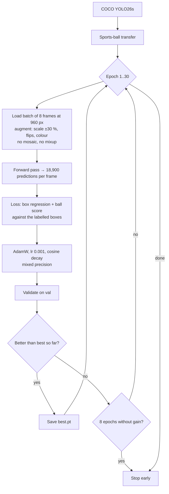
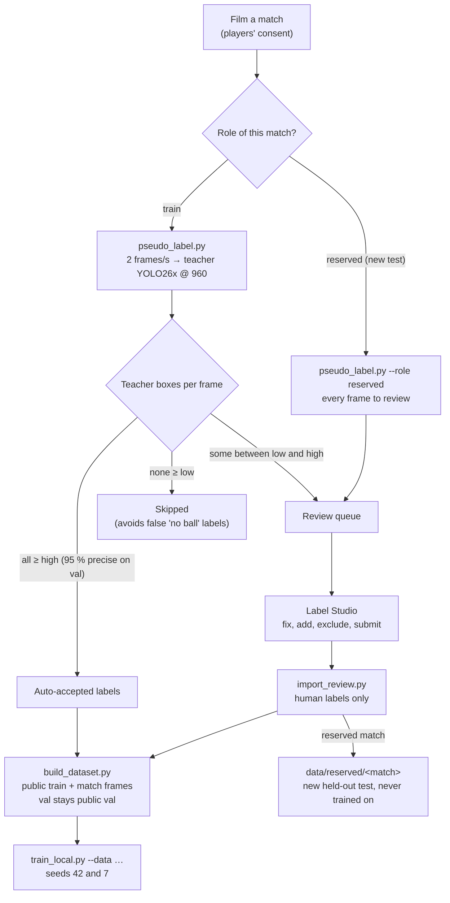
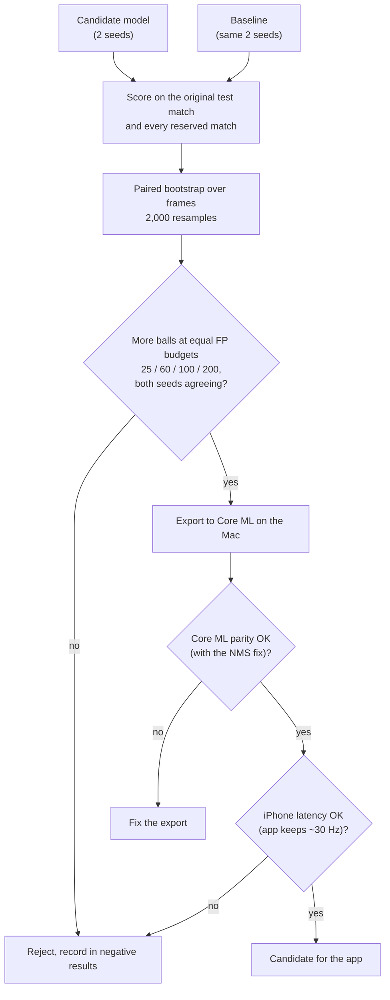
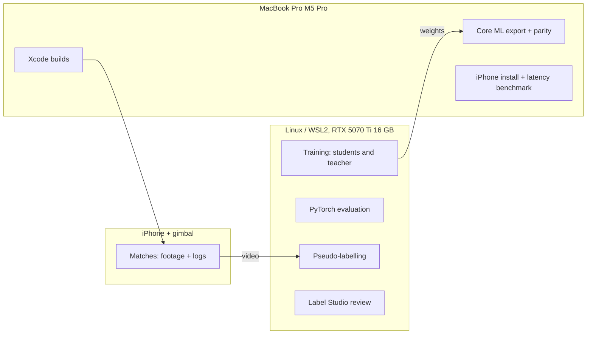

# How the box2boxcam ball model works, and how it is trained

This explains the system as it stands in the `rileyw` forks on 23 November 2026 (a fork-only note, not part of the upstream docs): the model, how the iPhone app uses it, how it is trained, and the local training loop added around it. Numbers come from the author's docs and from our own runs, cited where they appear.

## 1. The big picture

An iPhone on a DockKit gimbal films the match. Three models run on the phone about 30 times a second, a camera policy decides where to look, and the phone turns the gimbal's motors.

Only the **ball detector** is trained by this project. The person and pose models are stock Ultralytics models exported to Core ML (`scripts/fetch-models.sh` in the iOS repo).

## 2. The ball detector

The ball detector is a **YOLO26s** (about 9.5 M parameters), a single-stage detector. It looks at one image and predicts, for thousands of positions at once, "is there a ball here, and where exactly is its box?".

Key points:
- **Small balls are the hard part.** At 960 px a far ball is often under 16 px wide, only about 2 cells of the finest (stride 8) grid. The author reports that about 80 % of misses produce no candidate at all (`docs/negative_results.md`). Our test of running v1.0 at larger input sizes (up to 1536 px) found no extra balls, which suggests the limit is generalising to new matches rather than resolution (`MODEL_IMPROVEMENT_PLAN.md` §4).
- **Two heads exist, one is used.** YOLO26 has an NMS-free one-to-one head ("end2end") and a one-to-many head that needs NMS. Both v1.0 and its Core ML export use the **one-to-many head plus NMS** (`end2end: False`).

### Sports-ball transfer: how training starts

Training does not start from scratch. COCO-pretrained YOLO26s already detects 80 classes, one of them "sports ball" (class 32). The author's `SportsBallTransferTrainer` keeps the whole network and **only the classifier row for sports ball**, so training starts from a model that already knows roughly what a ball is.

## 3. How the app uses the model, and the NMS problem we found

The phone runs a **Core ML** export of the model. The published export is a pipeline: the network in fp16, then Apple's own NMS stage with confidence 0.1 and IoU 0.7, with classes padded to 80 (an Ultralytics workaround).

What the Core ML parity research found ([`docs/core_ml_parity_20261123.md`](https://github.com/rileyw/box2boxcam-football-vision/blob/feat/core-ml-parity/docs/core_ml_parity_20261123.md) on branch `feat/core-ml-parity`):

## 4. Training the model

### Data and splits

- **val is optimistic:** it is another clip of the training match, so it favours whatever fits that match.
- **test is the only independent judge.** Every look at it is logged in `training/RESULTS.md`, and the plan calls for new reserved matches because each look wears it out.

### The recipe (v1.0, reproduced locally in `training/train_local.py`)

On the RTX 5070 Ti this takes **about 12 minutes per seed** (30 epochs, 5.3 GiB). The author trains the same recipe on paid Hugging Face Jobs (A10G).

### What the public baseline showed (`training/RESULTS.md`)

Trained on public data only (about half of v1.0's data), seeds 42 and 7, scored on the held-out test match:
- **At equal false-positive budgets it matches v1.0**: +1 to +8 TP, every CI includes zero.
- **At a fixed threshold it is more confident**: more balls found, including +10 to +14 small balls at 0.25, but also more false positives.
- **Seeds disagree a lot at fixed thresholds** (19 FP apart at 0.45) but stay within about ±5 TP at equal budgets.

So experiments are judged at equal false-positive budgets, with at least 2 seeds.

## 5. Improving the model: the local loop

New footage is the main lever. The pipeline in `training/teacher/` turns a filmed match into training labels with a large **teacher** model and a human reviewer.

The teacher itself is trained once with the same recipe (YOLO26x, batch 4 to fit 16 GB). It is used only if `calibrate.py` shows it beats the student **on val**, with more balls at every false-positive budget and more small balls. That script also sets the auto-accept threshold, and it refuses to run on the test split.

## 6. Deciding whether a new model is better

The scoring is `scripts/evaluate_detector.py`:
- A box counts as found at IoU ≥ 0.5.
- Small balls (≤ 16 px) are counted separately.
- "Max TP at FP ≤ budget" compares models at the same false-positive cost, which removes differences in confidence calibration.

## 7. Who does what

## Where things live

| What | Where |
|---|---|
| Training, eval and research code | fork `rileyw/box2boxcam-football-vision` (`feat/core-ml-parity`, `ops/core-ml-parity-run`) |
| iOS app changes | fork `rileyw/box2boxcam-ios` (`fix/ball-candidate-dedup`, `feat/model-latency-benchmark`, …) |
| Local training, teacher pipeline, results | the local `training/` workspace, not in this repository: `train_local.py`, `teacher/`, `RESULTS.md` |
| Plans and research | the local workspace, not in this repository: `MODEL_IMPROVEMENT_PLAN.md`, `RESEARCH.md`, `drafts/` |
